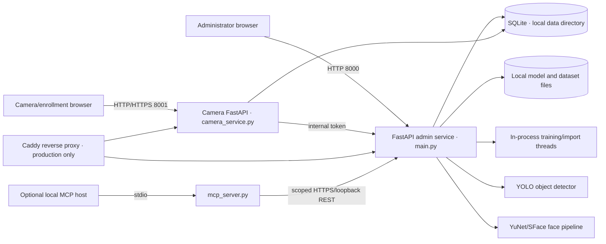
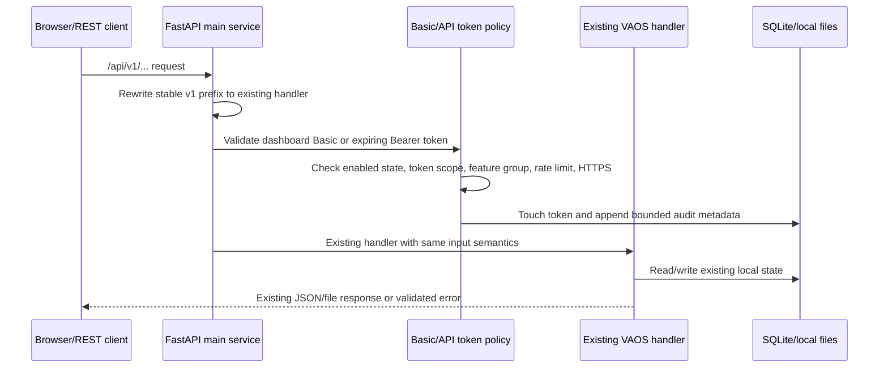

# VAOS architecture (working source)

This describes the inspected working tree, not an HA or production-certified design. Repository baseline: 1.1.0 at `dc98711`; the source tree adds API Explorer, Hardware Intelligence, Observability and related v1.1 work described below. A read-only health request to the existing admin listener on 127.0.0.1:8000 later reported 1.1.0; its loaded source path could not be established, and the camera listener was not rechecked. Neither existing service was restarted.

## Current component view

## Boundaries and persistence

- `main.py` contains the admin FastAPI app, REST handlers, HTML routes, SQLite access, model/dataset preparation, inference utilities, training lifecycle and tunnel commands.
- `camera_service.py` serves public camera/enrollment pages and frame intake, with internal model-status calls to the admin service.
- `templates/` and `static/` implement server-rendered pages with browser JavaScript/CSS; the current navigation is repeated in multiple templates rather than imported as a shared component.
- Existing VAOS tables are created/upgraded by `init_db()` at application import/startup through additive checks. Feature 8 observability uses a separate additive schema ledger (`vaos_schema_migrations`, current version 10) and makes a verified online SQLite backup before changing a non-empty database. No live database was migrated in this work.
- Model and dataset binaries are local files. Training and imports use in-process threads/locks. A process crash can lose live job state; current code does not provide durable job recovery.
- The optional MCP bridge calls documented REST endpoints; it is not an independent database or business-logic service and does not start VAOS.

## Current API request flow

The current working source exposes 69 versioned paths and 82 HTTP operations; see [API guide](API.md). Integration/token administration and human MCP approval decisions are Basic-only. API access and MCP start disabled. MCP writes from MCP-designated tokens require exact-request approval. The official SDK v2.3 process/client boundary passed locally against a synthetic API fixture; named agent-host UI and cross-OS CI remain unverified.

## Current v1.1.0 additions in the working tree

- The Built-in API Explorer consumes the generated OpenAPI document and invokes same-origin API routes through the existing authentication and authorization middleware. It is a presentation layer over the existing API, not a second business-logic service.
- Hardware Intelligence consumes the existing host metrics, GPU inventory, and device status. `hardware_intelligence.py` contains pure report-building logic and does not import PyTorch, initialize CUDA, run a benchmark, or mutate system configuration. The UI labels estimates separately from measurements.
- Tracking & Event Rules consumes detections and approximate IDs from `process_frame`; it adds rule/event tables and camera-scoped APIs without changing face sightings or creating a second tracker. `tracking_rules.py` is a pure evaluator for object count and dwell-in-region conditions.
- Project Bundles is a configuration-only `.vaosproject` archive. `project_bundles.py` validates a strict two-file manifest, checksum, fixed entry names, compression ratio and size limits without extracting files. It carries allowlisted engine settings plus dataset/model names, never file paths, credentials, images, or weights. Applying a bundle changes engine settings only.
- Observability adds a versioned additive telemetry schema, runtime sessions, redacted events and typed metric samples. It reuses existing hardware telemetry, the current admin authorization, and the shared SQLite file; it does not load models or collect camera imagery. Bounded CSV/PDF report jobs and an optional signed HTTPS, Syslog TLS, and OTLP/HTTP JSON event-delivery queue use that same store. Vendor-specific SIEM/SOAR compatibility remains unverified. See the [Feature 8 architecture and limits](observability/overview.md).
- MCP tools continue to call the REST API through the same policy checks; the MCP process does not access the database or model files directly.

## Historical feature boundaries and current deferrals

- AI Model Arena is deferred beyond v1.1.0 by product-owner scope decision; the historical read-only review records the earlier safety analysis. No Arena page, API, MCP tool, CLI command, or report is part of this release.
- Tracking rules should consume shared detections/temporary track IDs, not create a parallel detector. Persist rule definitions/events additively and label counts as approximate.
- Ready-to-Run Vision Applications are deferred beyond v1.1.0 by product-owner scope decision. Existing Video Review and detection/tracking workflows remain separate retained capabilities; no template gallery or template API is part of this release.
- Hardware advice consumes measured diagnostics and must separate facts from estimates. The initial page/report implementation is in the working tree; real-device compatibility testing remains pending.
- MCP approval must delegate into the same REST authorization and shared handlers. It must not add shell access or direct filesystem/database access.

## Deployment topology

Windows uses the launcher and local processes on ports 8000/8001. Production uses separate admin/camera containers, persistent `vaos-data`, and Caddy (see `compose.production.yaml`). GPU compose requires explicit NVIDIA runtime/package configuration. This source review did not build or launch Docker images, test remote proxy headers, or verify TLS/network policy.
